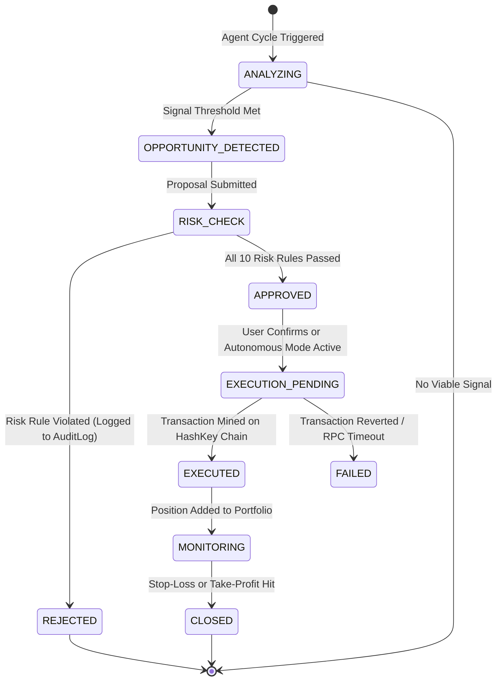
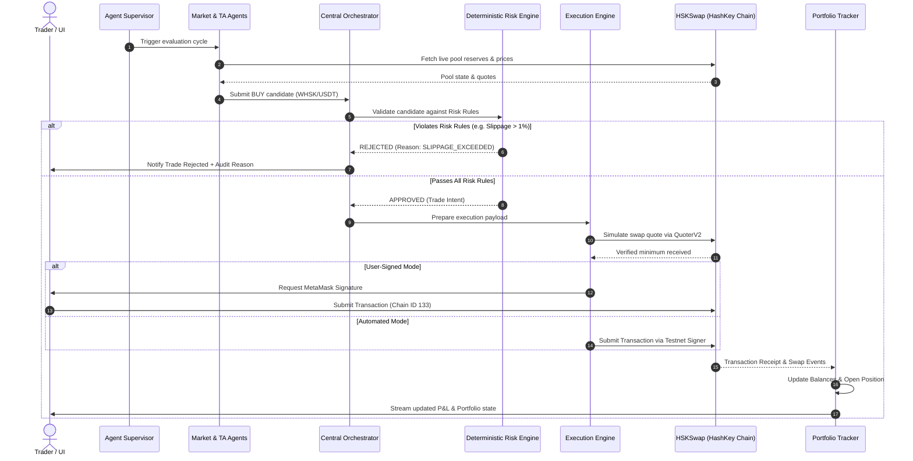

# OmniVault AI - System Architecture

**Target Hackathon:** HSK Chain India Hackathon  
**Track:** AI Agent Trading  
**System:** OmniVault AI - Autonomous Multi-Agent DEX Trading System on HashKey Chain  

---

## 1. High-Level Architectural Diagram

```
+---------------------------------------------------------------------------------------------------+
|                                       USER TRADING INTERFACE                                      |
|   +--------------------------+  +--------------------------+  +-------------------------------+   |
|   |  Overview Dashboard      |  |  Agent Control Center    |  |  Terminal & Technical Charts  |   |
|   +--------------------------+  +--------------------------+  +-------------------------------+   |
|   +--------------------------+  +--------------------------+  +-------------------------------+   |
|   |  Risk Center & Controls  |  |  Portfolio & P&L Manager |  |  Natural Language Assistant   |   |
|   +--------------------------+  +--------------------------+  +-------------------------------+   |
+-------------------------------------------------+-------------------------------------------------+
                                                  |
                                                  | WebSocket (Live Telemetry & Logs)
                                                  | REST API (Intents & Configurations)
                                                  v
+---------------------------------------------------------------------------------------------------+
|                                      BACKEND CORE (FastAPI)                                       |
|                                                                                                   |
|  +---------------------------------------------------------------------------------------------+  |
|  |                                  CENTRAL AGENT SUPERVISOR                                   |  |
|  |     Coordinates multi-agent execution cycles, health monitoring, and inter-agent telemetry  |  |
|  +----------------------------------------------+----------------------------------------------+  |
|                                                 |                                                 |
|        +-----------------------+----------------+-----------------------+                         |
|        |                       |                                        |                         |
|        v                       v                                        v                         |
|  +--------------------+  +--------------------+                   +--------------------+          |
|  | MARKET INTELLIGENCE|  |  ARBITRAGE AGENT   |                   | TECHNICAL ANALYSIS |          |
|  |      AGENT         |  |                    |                   |      AGENT         |          |
|  |  - Pool reserves   |  |  - Price spreads   |                   |  - RSI / MACD      |          |
|  |  - Volatility      |  |  - Fee calculations|                   |  - Bollinger Bands |          |
|  |  - Spread tracking |  |  - Net profit arb  |                   |  - EMA cross       |          |
|  +---------+----------+  +---------+----------+                   +---------+----------+          |
|            |                       |                                        |                     |
|            +-----------------------+----------------+-----------------------+                     |
|                                                     v                                             |
|                                           +--------------------+                                  |
|                                           |  LIQUIDITY AGENT   |                                  |
|                                           | - Depth analysis   |                                  |
|                                           | - Slippage impact  |                                  |
|                                           +---------+----------+                                  |
|                                                     | Candidate Trade Proposals                   |
|                                                     v                                             |
|  +---------------------------------------------------------------------------------------------+  |
|  |                                     CENTRAL ORCHESTRATOR                                    |  |
|  |   Aggregates agent proposals, scores opportunities, normalizes trade parameters             |  |
|  +----------------------------------------------+----------------------------------------------+  |
|                                                 |                                                 |
|                                                 v                                                 |
|  +---------------------------------------------------------------------------------------------+  |
|  |                                  DETERMINISTIC RISK ENGINE                                  |  |
|  |       MANDATORY MATHEMATICAL VALIDATION (AI AGENTS CANNOT OVERRIDE THESE RULES)             |  |
|  |   [Rule 1: Max Size]    [Rule 2: Max Slippage]    [Rule 3: Daily Loss]    [Rule 4: Drawdown]|  |
|  |   [Rule 5: Cooldown]    [Rule 6: Token Allowlist] [Rule 7: Freshness]     [Rule 8: Killswitch] |  |
|  +----------------------+----------------------------------------------------------------------+  |
|                         |                                                                         |
|            [REJECTED]   | [APPROVED]                                                              |
|                 v       v                                                                         |
|  +-------------------------+      +------------------------------------------------------------+  |
|  | Audit Log / Notification|      |                      CAPITAL ALLOCATOR                     |  |
|  +-------------------------+      | Computes exact allocation, position sizing, and stop loss  |  |
|                                   +-----------------------------+------------------------------+  |
|                                                                 |                                 |
|                                                                 v                                 |
|  +---------------------------------------------------------------------------------------------+  |
|  |                                      EXECUTION ENGINE                                       |  |
|  |   - Generates exact SwapRouter02 calldata and quotes via QuoterV2                           |  |
|  |   - Mode A: Prepares transaction for client-side MetaMask signing (Wagmi/Viem)              |  |
|  |   - Mode B: Server-side autonomous testnet execution with isolated trading key              |  |
|  +----------------------------------------------+----------------------------------------------+  |
|                                                 |                                                 |
|                                                 v                                                 |
|  +---------------------------------------------------------------------------------------------+  |
|  |                                      PORTFOLIO TRACKER                                      |  |
|  |   - Reconciles actual token balances post-swap against on-chain receipts                    |  |
|  |   - Calculates realized & unrealized P&L, Sharpe ratio, win rate, and position history      |  |
|  +---------------------------------------------------------------------------------------------+  |
+-------------------------------------------------+-------------------------------------------------+
                                                  |
                                                  v
+---------------------------------------------------------------------------------------------------+
|                                          HASHKEY CHAIN                                            |
|                                                                                                   |
|   +-------------------------------------------------------------------------------------------+   |
|   |   HashKey Testnet (Chain ID: 133 | RPC: https://testnet.hsk.xyz)                          |   |
|   |                                                                                           |   |
|   |   HSKSwap V3 Contracts:                                                                   |   |
|   |   * Factory: 0x2dC2c21D1049F786C535bF9d45F999dB5474f3A0                                  |   |
|   |   * SwapRouter02: 0xa6914E66690c6794244B5f66a09eAEbf66254237                             |   |
|   |   * QuoterV2: 0x73820d9eE5Bf1BfcD429580320FC7A374E8fa1cC                                 |   |
|   |   * WHSK: 0xCA8aAceEC5Db1e91B9Ed3a344bA026c4a2B3ebF6                                     |   |
|   |   * USDT: 0x98B6173A8B7DFc52ce8bc88f1184a918A1CCaa4F                                     |   |
|   |   * USDC.e: 0x18Ec8e93627c893ae61ae0491c1C98769FD4Dfa2                                   |   |
|   +-------------------------------------------------------------------------------------------+   |
+---------------------------------------------------------------------------------------------------+
```

---

## 2. Core Subsystems

### 2.1 Autonomous Agent Layer
Each agent operates as an independent worker with its own state machine, execution schedule, error boundary, and telemetry payload.

1. **Market Intelligence Agent (`agent_market_intelligence`):**
   - Continuously inspects pool states (reserves, fee tiers, recent volume).
   - Detects price movement velocity and unusual volatility.
   - Emits normalized pricing events.

2. **Arbitrage Agent (`agent_arbitrage`):**
   - Monitors multiple fee-tier pools (e.g. WHSK/USDT 0.05% vs 0.30% vs 1.00%).
   - Calculates the net arbitrage equation:
     $$\text{Net Profit} = \text{AmountOut}_{\text{Pool B}} - \text{AmountIn}_{\text{Pool A}} - \text{PoolFee}_A - \text{PoolFee}_B - \text{GasCost}$$
   - Filters out non-executable or negative-carry spreads.

3. **Technical Analysis Agent (`agent_technical_analysis`):**
   - Computes algorithmic indicators over normalized price candles:
     - Relative Strength Index (RSI - 14 period).
     - Moving Average Convergence Divergence (MACD - 12/26/9).
     - Exponential Moving Averages (EMA 9 and EMA 21 golden/death cross).
     - Bollinger Bands (20 period, 2 standard deviations).
   - Generates actionable signals (`BUY`, `SELL`, `HOLD`) with strict entry, invalidation, stop-loss, and take-profit coordinates.

4. **Liquidity Agent (`agent_liquidity`):**
   - Evaluates constant product / concentrated liquidity depth.
   - Computes price impact curve for proposed trade sizes:
     $$\Delta P = \frac{\text{TradeSize}}{\text{ActiveLiquidity} + \text{TradeSize}}$$
   - Vetoes any trade where estimated price impact exceeds the user's configured ceiling.

5. **Risk Management Engine (`engine_risk`):**
   - **Deterministic, non-probabilistic validator.**
   - Evaluates incoming trade opportunities against immutable risk criteria.
   - Outputs a binary `APPROVED` or `REJECTED` decision accompanied by explicit violation codes.

6. **Execution Agent (`agent_execution`):**
   - Constructs optimal swap transactions using HSKSwap's `SwapRouter02`.
   - Handles slippage parameters (`amountOutMinimum`), deadline encoding, and token approval verification.
   - Dispatches transactions either to the connected MetaMask wallet or the internal automated testnet signer.
   - Monitors transaction confirmation and extracts swap event logs.

7. **Portfolio Agent (`agent_portfolio`):**
   - Maintains real-time ledger of wallet balances, open positions, and closed trades.
   - Calculates mark-to-market valuations and realized P&L.
   - Performs reconciliation by periodically fetching on-chain ERC-20 balances from HashKey Testnet.

---

## 3. Central Orchestrator & State Machine

Every trade candidate traverses a deterministic finite state machine (FSM):



---

## 4. Deterministic Risk Engine: 10 Non-Negotiable Rules

The Risk Engine operates outside the LLM reasoning loop. The LLM can request policy changes (e.g. "set max slippage to 0.5%"), but cannot bypass validation during trade evaluation.

| Rule # | Parameter | Default Value | Description |
|---|---|---|---|
| **R1** | `max_trade_allocation_pct` | 10.0% | Max capital allocated to a single trade candidate |
| **R2** | `max_slippage_pct` | 1.0% | Max permissible deviation between quoted and realized price |
| **R3** | `max_daily_loss_pct` | 3.0% | Halts all trading if cumulative daily loss exceeds threshold |
| **R4** | `max_portfolio_drawdown_pct`| 10.0% | Halts trading if peak-to-trough equity drop exceeds limit |
| **R5** | `max_concurrent_positions` | 3 | Prevents over-leveraging and fragmented capital spread |
| **R6** | `token_allowlist` | WHSK, USDT, USDC.e | Rejects any unverified contract or untrusted token |
| **R7** | `data_freshness_seconds` | 60 seconds | Rejects opportunities derived from stale quotes/blocks |
| **R8** | `trading_cooldown_seconds` | 120 seconds | Minimum time between successive trades on the same pair |
| **R9** | `min_risk_reward_ratio` | 1.5 | Requires minimum $\frac{\text{Take Profit}}{\text{Stop Loss}}$ distance |
| **R10**| `emergency_pause_active` | `false` | Global circuit breaker instantly rejecting all new executions |

---

## 5. Sequence Diagram: Full Trade Lifecycle


